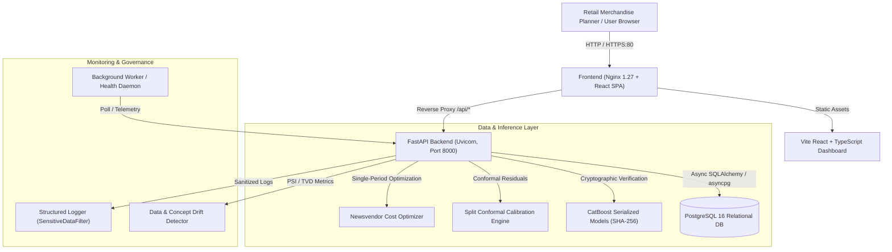

# R4 Demand Forecasting — Deployment, Operations, and Production Runbook

This document provides complete instructions for deploying, managing, operating, and troubleshooting the **R4 Cold-Start Retail Demand Forecasting Platform**.

---

## 1. System Architecture Overview

The R4 platform consists of four containerized services orchestrated via Docker Compose:



---

## 2. Quickstart with Docker Compose

### Prerequisites
- Docker Engine $\ge 24.0$
- Docker Compose $\ge 2.20$
- 4GB RAM minimum (8GB recommended for CatBoost training)

### Step 1: Environment Setup
Copy the production environment template:
```bash
cp .env.example .env
```
Ensure you update `SECRET_KEY`, `POSTGRES_PASSWORD`, and API keys in `.env` before deploying to staging or production.

### Step 2: Build and Launch Services
Launch all services in detached mode:
```bash
docker compose up -d --build
```

### Step 3: Verify Service Health
Check that all containers report healthy status:
```bash
docker compose ps
```
Expected output:
| Name | Command | State | Ports | Health |
| :--- | :--- | :--- | :--- | :--- |
| `r4-postgres` | `postgres` | Up | `0.0.0.0:5432->5432/tcp` | `healthy` |
| `r4-backend` | `/app/docker-entrypoint.sh` | Up | `0.0.0.0:8000->8000/tcp` | `healthy` |
| `r4-frontend` | `nginx -g 'daemon off;'` | Up | `0.0.0.0:80->80/tcp, 0.0.0.0:3000->80/tcp` | `healthy` |
| `r4-worker` | `python scripts/verify_api_live.py ...` | Up | N/A | `Up` |

### Step 4: Access Interfaces
- **Interactive Web Dashboard:** `http://localhost/` or `http://localhost:3000/`
- **FastAPI OpenAPI Documentation:** `http://localhost:8000/docs`
- **Health Check Endpoint:** `http://localhost:8000/health`
- **Readiness Probe:** `http://localhost:8000/ready`
- **Telemetry Metrics:** `http://localhost:8000/api/v1/monitoring/telemetry`

### Step 5: Stop Services
```bash
# Graceful stop preserving database volumes
docker compose down

# Stop and wipe persistent database volumes (Clean slate)
docker compose down -v
```

---

## 3. Local Development Setup (Without Docker)

For fast iterative local development with Python and Vite:

### 1. Python Virtual Environment
```bash
python -m venv .venv
# Windows PowerShell:
.venv\Scripts\Activate.ps1
# Linux/macOS:
source .venv/bin/activate

pip install --upgrade pip
pip install -r requirements.txt
pip install -r requirements-dev.txt
```

### 2. Database Schema and Development Seeding
Initialize the SQLite database with full evaluation and catalogue records:
```bash
python scripts/init_db.py --sales-limit 10000
```

### 3. Run FastAPI Backend Server
```bash
uvicorn src.api.main:app --host 127.0.0.1 --port 8000 --reload
```

### 4. Run React TypeScript Frontend
In a separate terminal:
```bash
cd frontend
npm install
npm run dev
```
Open `http://localhost:5173/` in your browser.

---

## 4. Database Operations & Runbooks

### A. Running Migrations (Alembic)
The container entrypoint runs migrations automatically. To run manually:
```bash
# Check current migration revision
alembic current

# Upgrade to latest revision (head)
alembic upgrade head

# Downgrade by one revision
alembic downgrade -1

# Generate a new auto-detected migration from SQLAlchemy model changes
alembic revision --autogenerate -m "add_new_column_to_skus"
```

### B. Safe Development Seeding vs Production Protection
`scripts/init_db.py` contains an active safeguard preventing accidental contamination or resetting of production databases.

- **Development Mode:** Seeding runs freely when `ENVIRONMENT=development`.
- **Production Mode:** If `ENVIRONMENT=production`, executing `init_db.py` without explicit authorization will abort with:
  ```
  CRITICAL SAFETY GUARD: Seeding or resetting a production database is prohibited to prevent data contamination!
  ```
  To explicitly seed reference catalogues in a fresh production cluster, you must provide the override flag:
  ```bash
  python scripts/init_db.py --force-production-seed --sales-limit 10000
  ```
  Or set environment variable: `ALLOW_DEV_SEED=true`.

### C. Backup and Recovery (PostgreSQL)

#### Backup:
```bash
# Export compressed custom format backup with timestamp
docker exec -t r4-postgres pg_dump \
    -U postgres \
    -d r4_forecast_db \
    -F c \
    -b \
    -v \
    -f /var/lib/postgresql/data/backup_r4_$(date +%Y%m%d_%H%M%S).dump

# Copy backup archive out of container to host
docker cp r4-postgres:/var/lib/postgresql/data/backup_r4_*.dump ./backups/
```

#### Restore:
```bash
# Restore archive to clean database
docker exec -i r4-postgres pg_restore \
    -U postgres \
    -d r4_forecast_db \
    -v \
    -c \
    /var/lib/postgresql/data/backup_r4_20261018_200000.dump
```

---

## 5. Machine Learning Operations (MLOps) Pipeline

To execute the end-to-end model pipeline from raw data to inventory decisions:

```bash
# 1. Feature Engineering & Leakage-Safe Data Ingestion
python scripts/run_pipeline.py

# 2. Category Launch Curve Baselines & Gower Analogue Retrieval
python scripts/run_phase3_baselines.py

# 3. Train Supervised CatBoost GBDT Model
python scripts/train_supervised.py --iterations 300 --learning-rate 0.05 --depth 6

# 4. Split Conformal Residual Uncertainty Calibration (80% & 90% bounds)
python scripts/evaluate_uncertainty.py

# 5. Single-Period Newsvendor Initial Order Optimization
python scripts/optimize_inventory.py

# 6. TreeSHAP Additivity Explanations & Confidence Tiering
python scripts/generate_explanations.py

# 7. Comprehensive Live API Verification
python scripts/verify_api_live.py
```

---

## 6. Production Security & Hardening Guide

### A. TLS/HTTPS Termination
Never expose the FastAPI backend directly to the public internet on unencrypted HTTP.
1. Deploy Nginx, Traefik, or an AWS Application Load Balancer in front of the application.
2. Enforce TLS 1.3 with forward secrecy.
3. Redirect all port 80 HTTP traffic to port 443 HTTPS.

Sample TLS Nginx block:
```nginx
server {
    listen 443 ssl http2;
    server_name forecast.retaildomain.com;

    ssl_certificate /etc/letsencrypt/live/forecast.retaildomain.com/fullchain.pem;
    ssl_certificate_key /etc/letsencrypt/live/forecast.retaildomain.com/privkey.pem;
    ssl_protocols TLSv1.2 TLSv1.3;
    ssl_ciphers HIGH:!aNULL:!MD5;

    location / {
        proxy_pass http://localhost:80;
        proxy_set_header X-Forwarded-Proto https;
        proxy_set_header Host $host;
    }
}
```

### B. Secret Management & Credential Hygiene
- **Zero Hardcoded Secrets:** No API keys, database credentials, or secret keys are committed to Git.
- **Environment Injection:** Load production secrets from an approved Secret Manager (e.g. AWS Secrets Manager, HashiCorp Vault, Azure Key Vault, or Kubernetes Secrets).
- **Log Scrubbing:** All application logging is filtered through `SensitiveDataFilter`, which automatically redacts API keys, Bearer tokens, and password fields.

### C. Role-Based Access Control (RBAC) Matrix
The API enforces role-based authorization via `X-API-Key` or `Authorization: Bearer <key>` headers:

| Role | Permitted Actions | Endpoints |
| :--- | :--- | :--- |
| **`viewer`** | Read models, query forecasts, review confidence scores, read evaluation reports. | `GET /api/v1/models`<br>`GET /api/v1/forecasts/*`<br>`GET /api/v1/reports/*` |
| **`operator`** | Ingest custom CSV datasets, generate inventory optimizations, run forecast batches. | `POST /api/v1/forecasts`<br>`POST /api/v1/inventory/optimize` |
| **`admin`** | Trigger model training, manage data imports, approve model promotion gates. | `POST /api/v1/data/import`<br>`POST /api/v1/models/train`<br>`POST /api/v1/monitoring/governance/evaluate` |

### D. Model Promotion Governance Safeguard
> [!IMPORTANT]
> **Strict Governance Against Automated Drift Promotion:** In accordance with production MLOps standards, detecting data or distribution drift **never automatically triggers a model promotion**. Automated promotion requires meeting both:
> 1. Official Evaluation Benchmark: $WAPE \le 0.2800$.
> 2. Baseline Superiority: Candidate model must demonstrate lower WAPE than hierarchical category and analogue baselines.

### E. Runtime Monitoring & Prometheus Scraping
Exposed monitoring endpoints ready for Datadog, Prometheus, or Grafana Agent:
- `GET /api/v1/monitoring/telemetry`: Request latency percentiles (p50, p95, p99), error rates, throughput.
- `GET /api/v1/monitoring/drift`: Population Stability Index (PSI) and Total Variation Distance (TVD) against training baselines.

---

## 7. Troubleshooting Guide

| Issue | Likely Cause | Solution |
| :--- | :--- | :--- |
| **Port 8000 or 80 already in use** | Local process or zombie container holding the port. | Change `BACKEND_PORT=8001` or `FRONTEND_PORT=8080` in `.env`, or kill the process using `netstat -ano \| findstr :8000`. |
| **Backend fails healthcheck on startup** | Database migrations running or waiting for Postgres socket. | Inspect backend container logs: `docker compose logs backend`. Entrypoint waits for Postgres health. |
| **`401 Unauthorized` on API request** | Missing or incorrect `X-API-Key` header. | Supply valid key configured in `.env` (e.g. `X-API-Key: r4-admin-key-2026`). |
| **`ModelIntegrityError: SHA-256 verification failed`** | Model binary weights tampered or corrupted. | Check checksum in `model_config.json` against `sha256sum catboost_model.cbm`. Retrain or restore artifact. |
| **`CRITICAL SAFETY GUARD: Seeding production database prohibited`** | Attempting to run `init_db.py` with `ENVIRONMENT=production`. | Pass `--force-production-seed` or set `ALLOW_DEV_SEED=true` if intentionally bootstrapping production data. |
| **CORS errors in browser console** | Frontend origin not present in backend whitelist. | Update `ALLOWED_ORIGINS` in `.env` to include the browser's origin URL and restart backend. |
