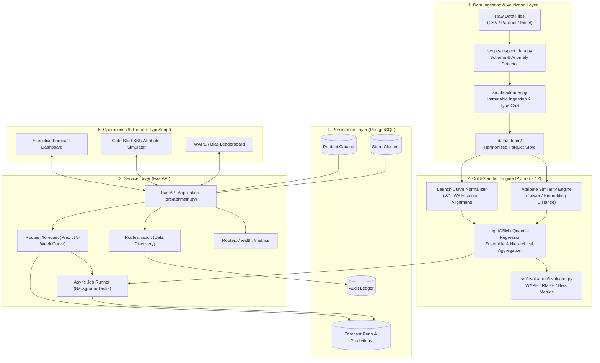

# SYSTEM ARCHITECTURE — R4 New Product Demand Forecasting

**Architecture Version:** 1.0.0  
**Target Environment:** Python 3.12+, FastAPI, PostgreSQL, React TypeScript  
**Design Paradigm:** Modular Monolith with Asynchronous Analytical Processing  

---

## 1. Architectural Principles & Vision

Forecasting weekly sales for new products with zero sales history (cold-start) requires a specialized architecture fundamentally distinct from mature SKU time-series forecasting. 

The R4 architecture separates:
1. **High-throughput Ingestion & Schema Discovery**: Immutable file audit, automatic type casting, and anomaly fencing.
2. **Cold-Start Feature Engineering & Similarity Engine**: Attribute embedding, cluster pooling, and launch profile matching.
3. **Forecasting Engine**: Multi-horizon recursive and direct GBDT / ElasticNet regression with quantile estimation.
4. **FastAPI Application Layer**: Clean REST endpoints, asynchronous job scheduling, and Pydantic validation.
5. **PostgreSQL Relational Layer**: ACID audit trail, model registry metadata, and prediction history.
6. **React TypeScript Operational UI**: Interactive forecast adjustments, attribute scenario testing, and performance metrics.

---

## 2. End-to-End System Architecture Diagram



---

## 3. Component Deep Dive

### 3.1 Data Ingestion & Inspection Layer (`src/data/`)
- **`src/data/inspector.py`**: Automated schema, null count, duplicate, and column heuristic analyzer.
- **`src/data/loader.py`**: Pure-function loaders using PyArrow and Pandas for ultra-fast Parquet/CSV memory mapping.
- **`src/data/schema.py`**: Pydantic models guaranteeing structural contract verification before downstream training.

### 3.2 Cold-Start Feature & Modeling Engine (`src/models/`)
- **Launch Curve Profiler**: Normalizes historical sales for ~1,200 mature SKUs into $(W_1, \dots, W_8)$ indexed vectors.
- **Attribute Similarity Matcher**:
  - Distance metrics: Gower distance for mixed categorical/numerical product attributes.
  - Nearest Neighbor transfer: Identifies top-$K$ historical donor SKUs matching cold-start target attributes.
- **LightGBM Multi-output / Direct Quantile Regressor**:
  - Direct 8-step forecasting: Trains dedicated quantile estimators ($\tau = 0.1, 0.5, 0.9$) for each horizon week $h \in [1..8]$.
  - Minimizes WAPE via Huber/L1 loss function objectives.

### 3.3 Evaluation Engine (`src/evaluation/`)
- **`src/evaluation/metrics.py`**: Vectorized NumPy implementation of WAPE, RMSE, MAE, Bias, and Pinball loss.
- **`src/evaluation/evaluator.py`**: Validation pipeline verifying submission schema, computing horizon-wise scores, and flagging anomalies.

### 3.4 API & Asynchronous Backend (`src/api/`)
- **FastAPI Framework**:
  - `/api/v1/health`: Liveness and readiness probes.
  - `/api/v1/audit/status`: Reports dataset discovery findings and schema health.
  - `/api/v1/forecast/predict`: Accepts new SKU attribute payloads and returns predicted 8-week curves with prediction intervals.
  - `/api/v1/forecast/batch`: Triggers batch execution for the 150 evaluation SKUs.
- **Database Engine (SQLAlchemy + AsyncPG)**:
  - Connection pooling with connection health recycling.
  - Declarative models mapping `product_catalog`, `store_clusters`, `forecast_runs`, and `forecast_values`.

### 3.5 React TypeScript Operations UI (`frontend/`)
- **Vite + React 18 + TypeScript**:
  - Modern component architecture with type-safe API client interfaces.
  - Visualizations: 8-week demand trajectory curves, donor SKU comparisons, and confidence envelopes.
  - Scenario planner: Allows inventory planners to adjust MSRP, category, or cluster distribution and observe forecast impact in real time.

---

## 4. Database Schema Design (PostgreSQL)

```sql
-- Product Catalog
CREATE TABLE product_catalog (
    sku_id VARCHAR(64) PRIMARY KEY,
    product_name VARCHAR(255),
    category_l1 VARCHAR(64) NOT NULL,
    category_l2 VARCHAR(64),
    brand VARCHAR(64),
    base_price NUMERIC(10, 2) NOT NULL,
    unit_cost NUMERIC(10, 2),
    launch_date DATE,
    lifecycle_stage VARCHAR(32) NOT NULL,
    created_at TIMESTAMP WITH TIME ZONE DEFAULT CURRENT_TIMESTAMP
);

-- Store Clusters
CREATE TABLE store_clusters (
    store_id VARCHAR(32) PRIMARY KEY,
    cluster_id VARCHAR(32) NOT NULL,
    region VARCHAR(64),
    store_tier VARCHAR(16),
    is_active BOOLEAN DEFAULT TRUE
);

-- Forecast Experiment Runs
CREATE TABLE forecast_runs (
    run_id UUID PRIMARY KEY DEFAULT gen_random_uuid(),
    model_name VARCHAR(64) NOT NULL,
    model_version VARCHAR(32) NOT NULL,
    parameters JSONB,
    status VARCHAR(32) NOT NULL,
    wape NUMERIC(6, 4),
    rmse NUMERIC(10, 4),
    created_at TIMESTAMP WITH TIME ZONE DEFAULT CURRENT_TIMESTAMP
);

-- Forecast Predictions
CREATE TABLE forecast_predictions (
    prediction_id BIGSERIAL PRIMARY KEY,
    run_id UUID REFERENCES forecast_runs(run_id) ON DELETE CASCADE,
    sku_id VARCHAR(64) NOT NULL,
    horizon_week INTEGER NOT NULL CHECK (horizon_week BETWEEN 1 AND 8),
    predicted_sales NUMERIC(10, 2) NOT NULL,
    p10_sales NUMERIC(10, 2),
    p90_sales NUMERIC(10, 2),
    created_at TIMESTAMP WITH TIME ZONE DEFAULT CURRENT_TIMESTAMP,
    CONSTRAINT uq_run_sku_week UNIQUE (run_id, sku_id, horizon_week)
);
```

---

## 5. Security, Logging, and Operational Hardening
- **Secrets Management**: Configuration injected via `.env` with strict Pydantic `BaseSettings` validation.
- **Audit Logging**: Structured JSON logging capturing all incoming requests, pipeline execution times, and schema validation failures.
- **CORS & Rate Limiting**: Production-ready middleware configured in FastAPI.
