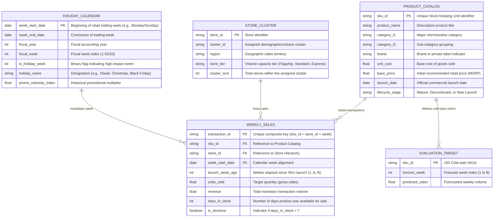

# DATA DICTIONARY — R4 New Product Demand Forecasting

## 1. Overview & Cold-Start Problem Context
The R4 New Product Demand Forecasting challenge requires predicting weekly sales volumes for the first eight weeks ($W_1$ to $W_8$) across 150 newly launched Stock Keeping Units (SKUs). These target evaluation products contain zero historical transaction history at launch time, rendering classical univariate autoregressive time-series models (e.g., ARIMA, Prophet, Holt-Winters) inapplicable at the SKU level. 

Instead, forecasts must be driven by:
1. Cross-sectional attribute embeddings (hierarchical product categories, attributes, specifications).
2. Historical launch profiles learned from approximately 1,200 mature or discontinued reference SKUs.
3. Spatial demand transfer functions across store clusters.
4. Exogenous seasonal drivers and holiday calendar alignments.

> **Constraint Adherence**: In accordance with Phase 1 constraints, column names and field types described below represent the **Formal Target Ingestion Contract** derived from the problem specifications. Once physical raw files are deposited in `data/raw/`, `scripts/inspect_data.py` discovers source column aliases, validates types, and binds them to this schema without assumption.

---

## 2. Expected Domain Entities & Entity Relationship Model

---

## 3. Entity Specification & Field Definitions

### 3.1 Product Catalog (`PRODUCT_CATALOG`)
Represents the structural master attributes for all ~1,200 mature reference SKUs and the 150 cold-start evaluation SKUs.

| Field Name | Expected Logical Type | Nullable | Description & Domain Rules |
| :--- | :--- | :--- | :--- |
| `sku_id` | `VARCHAR(64)` | No | Primary Key. Alphanumeric identifier unique across the enterprise. |
| `product_name` | `VARCHAR(255)` | Yes | Text description; candidate for NLP attribute tokenization. |
| `category_l1` | `VARCHAR(64)` | No | High-level merchandise department (e.g., Apparel, Electronics, Grocery). |
| `category_l2` | `VARCHAR(64)` | Yes | Sub-category grouping (e.g., Outerwear, Footwear). |
| `brand` | `VARCHAR(64)` | Yes | Brand identity; strong driver of cold-start baseline elasticity. |
| `unit_cost` | `DECIMAL(10,2)` | Yes | COGS baseline used for inventory risk weighting. |
| `base_price` | `DECIMAL(10,2)` | No | Listed retail shelf price at introduction. |
| `launch_date` | `DATE` | No | Date on which the SKU was first made available to customers. |
| `lifecycle_stage` | `VARCHAR(32)` | No | Values: `MATURE`, `DISCONTINUED`, or `NEW_EVALUATION`. |

### 3.2 Store Clusters & Regional Hierarchy (`STORE_CLUSTER`)
Store-level grouping enables cross-store pooling and spatial demand aggregation.

| Field Name | Expected Logical Type | Nullable | Description & Domain Rules |
| :--- | :--- | :--- | :--- |
| `store_id` | `VARCHAR(32)` | No | Store location identifier. |
| `cluster_id` | `VARCHAR(32)` | No | Micro-demographic or sales velocity cluster assignment. |
| `region` | `VARCHAR(64)` | Yes | Geographic territory (e.g., North, West, Urban Central). |
| `store_tier` | `VARCHAR(16)` | Yes | Tier classification (Tier 1 Flagship, Tier 2 Suburban, Tier 3 Express). |
| `active_flag` | `BOOLEAN` | No | Operational status of store location. |

### 3.3 Holiday & Promotional Calendar (`HOLIDAY_CALENDAR`)
Provides temporal alignment across calendar weeks, normalizing movable feasts and holiday shocks.

| Field Name | Expected Logical Type | Nullable | Description & Domain Rules |
| :--- | :--- | :--- | :--- |
| `week_start_date` | `DATE` | No | ISO weekly start date (Monday or Sunday boundary, consistent throughout). |
| `fiscal_year` | `INTEGER` | No | 4-digit fiscal year. |
| `fiscal_week` | `INTEGER` | No | Week index 1 to 52 (or 53 in leap fiscal years). |
| `is_holiday_week` | `INTEGER` | No | Binary flag (`1` if containing a major holiday, `0` otherwise). |
| `holiday_name` | `VARCHAR(100)` | Yes | Descriptive label for holiday event. |
| `holiday_weight` | `FLOAT` | Yes | Impact factor estimated from prior historical annual lift. |

### 3.4 Historical Weekly Sales (`WEEKLY_SALES`)
Historical transactional panel data covering ~1,200 mature/discontinued SKUs.

| Field Name | Expected Logical Type | Nullable | Description & Domain Rules |
| :--- | :--- | :--- | :--- |
| `sku_id` | `VARCHAR(64)` | No | Foreign key referencing `PRODUCT_CATALOG.sku_id`. |
| `store_id` | `VARCHAR(32)` | No | Foreign key referencing `STORE_CLUSTER.store_id`. |
| `week_start_date` | `DATE` | No | Weekly temporal anchor. |
| `launch_week_age` | `INTEGER` | No | $1 \le \text{age} \le 8$ during introduction, monotonically increasing thereafter. |
| `units_sold` | `FLOAT` | No | Weekly sales count (target variable). $\ge 0$. |
| `revenue` | `DECIMAL(12,2)` | Yes | Total sales value in local currency. |
| `days_in_stock` | `INTEGER` | Yes | Trading days during the week with positive inventory ($0 \le d \le 7$). |
| `is_stockout` | `BOOLEAN` | Yes | True if supply truncation occurred during the period. |

---

## 4. Cold-Start Specific Nuances

### 4.1 Launch-Week Age Formulation
For any SKU $i$ with launch date $T_i^{launch}$ and trading week start $t$:
$$\text{launch\_week\_age}_{i, t} = \left\lfloor \frac{t - T_i^{launch}}{7 \text{ days}} \right\rfloor + 1$$
- $\text{launch\_week\_age} = 1$: The introductory week of commercial release.
- Evaluation focuses strictly on $\text{launch\_week\_age} \in \{1, 2, 3, 4, 5, 6, 7, 8\}$.
- Reference curves for mature products must be aligned at $\text{launch\_week\_age}$ rather than arbitrary calendar dates to capture initial launch surge and adoption decay.

### 4.2 Distinguishing Missing Sales vs. Zero Sales vs. Stockouts
1. **Missing Record (Sparse Grid)**: The combination $(sku, store, week)$ is absent from the dataset. Requires grid densification with explicit imputation checks.
2. **Genuine Zero Sales ($units\_sold = 0, days\_in\_stock = 7$)**: The item was physically present on shelves for all 7 days, but customer demand was zero. This is valid demand signal ($y=0$).
3. **Censored Stockout ($units\_sold \ge 0, days\_in\_stock < 7$ or $is\_stockout = \text{True}$)**: Unfulfilled demand was truncated because inventory was exhausted. Treating this as unconstrained sales biases the forecast downward. Uncensoring techniques (Tobit regression / Kaplan-Meier estimation) apply.
